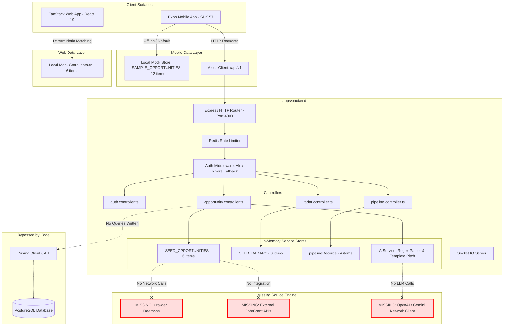
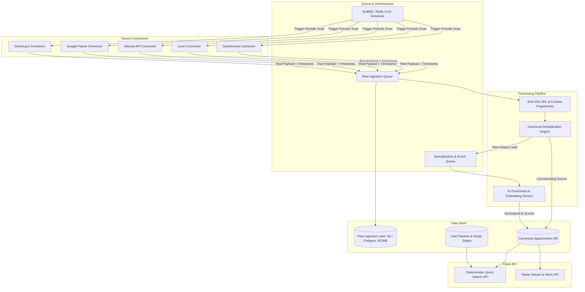

# LEED — Comprehensive System Audit & Technical Assessment

**Document Version:** 1.0.0  
**Audit Date:** October 14, 2026  
**Auditor:** Antigravity Autonomous Systems Engineering Team  
**Scope:** Repository-wide inspection of monorepo architecture, data discovery pipelines, external integrations, AI dependencies, data provenance, storage models, and mobile/web implementations.  
**Constraint Adherence:** Read-only inspection; no destructive actions, no dependency changes, no code modifications, no live external scraping unauthorized by verified access.

---

## 1. Executive Summary

### 1.1 Core Finding: The "Prototype Disconnect"
Leed (historically developed under the working package namespace `prospectai`) possesses a modern, responsive, and visually polished multi-surface presentation tier across **Mobile (React Native 0.86 / Expo SDK 57)** and **Web (React 19 / TanStack Start / Nitro SSR)**, backed by a structured **Express / Node.js 20 ESM** backend and a 18-model **Prisma / PostgreSQL** schema.

However, an evidence-based audit reveals a fundamental disconnect between system claims and technical reality:

> **The system currently possesses zero automated web scrapers, zero live crawler daemons, zero external API connectors, zero feed ingestors, and zero live LLM network integrations.**

Every opportunity, search result, radar scan, and AI proposal encountered across the mobile and web surfaces is powered by **static hardcoded in-memory arrays** or **deterministic regex/keyword matchers**.

- Mobile claims: `"124 active crawlers"` and `"Search Across 124 Sources"` ([apps/mobile/app/(tabs)/radar.tsx:45](file:///Users/mac/Documents/LEED/apps/mobile/app/(tabs)/radar.tsx#L45), [apps/mobile/app/action.tsx:1372](file:///Users/mac/Documents/LEED/apps/mobile/app/action.tsx#L1372)). In reality, the crawler count is a hardcoded static UI string.
- Mobile search execution: In [apps/mobile/app/action.tsx:251-265](file:///Users/mac/Documents/LEED/apps/mobile/app/action.tsx#L251-L265), queries execute a simple JavaScript `.filter()` with a simulated 450ms `setTimeout()` over 12 static objects in [apps/mobile/constants/mockData.ts](file:///Users/mac/Documents/LEED/apps/mobile/constants/mockData.ts).
- Web discovery execution: In [apps/web/src/features/prospect/data.ts:39-52](file:///Users/mac/Documents/LEED/apps/web/src/features/prospect/data.ts#L39-L52), the web search explicitly states: *"Deterministic, local-only matching for the preview; no search service or AI is called."*
- Backend discovery execution: In [apps/backend/src/services/opportunity.service.ts:6-259](file:///Users/mac/Documents/LEED/apps/backend/src/services/opportunity.service.ts#L6-L259), the API queries an in-memory array `SEED_OPPORTUNITIES` (6 hardcoded records). Database models defined in [apps/backend/prisma/schema.prisma](file:///Users/mac/Documents/LEED/apps/backend/prisma/schema.prisma) are bypassed entirely by the controllers.
- Backend AI processing: In [apps/backend/src/services/ai.service.ts:7-62](file:///Users/mac/Documents/LEED/apps/backend/src/services/ai.service.ts#L7-L62), `AIService.interpretSearchPrompt()` uses regex string splitting and `.includes('remote')`. `generatePitch()` uses string template concatenation. No OpenAI, Anthropic, or Gemini SDK calls are made.
- Radar automated scans: In [apps/backend/src/services/radar.service.ts:114-122](file:///Users/mac/Documents/LEED/apps/backend/src/services/radar.service.ts#L114-L122), triggering a radar scan executes: `radar.totalFound += 2; radar.newSinceLastCheck = 2;`. No background network jobs or crawl processes exist.

### 1.2 Capability Status Scorecard

| System Capability | Implementation Status | Evidence / Verification Path |
| :--- | :--- | :--- |
| **Mobile App UI & Navigation** | **Verified working** | Expo 57 / React Native 0.86; typechecks clean; interactive screens |
| **Web App UI & SSR** | **Verified working** | Nitro SSR / React 19 / TanStack Start; builds and compiles clean |
| **Backend API Structure** | **Implemented, not verified** | Express ESM router with JWT auth & rate limiting; compiles clean |
| **Database Schema Definition** | **Implemented, not verified** | 18 Prisma models in `schema.prisma`; schema is valid |
| **Database Persistence Layer** | **Placeholder/mock** | Controllers bypass Prisma and manipulate in-memory JavaScript arrays |
| **Authentication Flow** | **Placeholder/mock** | Always signs JWT for demo user Alex Rivers; does not check DB password |
| **Real External Data Ingestion** | **Missing** | 0 crawlers, 0 scraper connectors, 0 feed parsers, 0 job board APIs |
| **AI Prompt Reasoning / NLP** | **Placeholder/mock** | Regex/string pattern matching; no live LLM SDK integration |
| **Automated Crawl Scheduling** | **Missing** | No BullMQ, Temporal, pg-boss, or Cron daemons configured |
| **Lead Provenance Architecture** | **Partially implemented** | Schema stores single `originalUrl`, but lacks raw payload/snapshot models |
| **Deduplication Engine** | **Missing** | No cross-source entity resolution, URL canonicalization, or fingerprinting |
| **Automated Testing Suite** | **Missing** | 0 unit, integration, or E2E tests found anywhere in the monorepo |

---

## 2. Repository and Technology-Stack Overview

The project is structured as a monorepo configured with npm workspaces and Turborepo.

### 2.1 Workspace Structure
```
LEED/
├── apps/
│   ├── backend/          # Node.js Express REST API & Socket.IO server
│   │   ├── prisma/       # Prisma schema & migrations
│   │   ├── src/
│   │   │   ├── controllers/  # Auth, Opportunity, Pipeline, Proposal, Radar
│   │   │   ├── middleware/   # JWT auth, Redis rate limiting, error handler
│   │   │   ├── routes/       # Express route definitions under /api/v1
│   │   │   ├── services/     # Business logic & mock seed stores
│   │   │   └── utils/        # Redis, Prisma client, Zod schemas
│   │   └── package.json
│   ├── mobile/           # Expo SDK 57 / React Native 0.86 application
│   │   ├── app/          # Expo Router file-based screens
│   │   ├── components/   # Atomic UI, radar cards, bottom sheets
│   │   ├── constants/    # Theme tokens, Config, mockData.ts
│   │   ├── context/      # AuthContext, PipelineContext, ThemeContext
│   │   ├── services/     # Axios API client, queryClient, local services
│   │   └── package.json
│   └── web/              # TanStack Start / Nitro SSR / Vite web application
│       ├── src/
│       │   ├── components/ui/ # Radix UI primitives & Tailwind CSS
│       │   ├── features/prospect/ # In-memory prototype state & components
│       │   └── routes/       # TanStack file-based routes
│       └── package.json
├── packages/
│   ├── config/           # Shared TypeScript & build configs
│   ├── types/            # @prospect/types shared TypeScript domain models
│   └── utils/            # @prospect/utils formatting and date helpers
├── package.json          # Monorepo root scripts & dependencies
└── turbo.json            # Turbo pipeline definition
```

### 2.2 Detailed Technology Stack Matrix

| Layer | Framework / Library | Version | Configuration / Location | Purpose |
| :--- | :--- | :--- | :--- | :--- |
| **Mobile Runtime** | React Native | 0.86.3 | [apps/mobile/package.json](file:///Users/mac/Documents/LEED/apps/mobile/package.json) | Cross-platform iOS/Android runtime |
| **Mobile Toolchain** | Expo SDK | 57.0.27 | [apps/mobile/app.json](file:///Users/mac/Documents/LEED/apps/mobile/app.json) | Managed workflow, Hermes engine, CNG |
| **Mobile Router** | Expo Router | 57.0.25 | [apps/mobile/app/](file:///Users/mac/Documents/LEED/apps/mobile/app) | File-based navigation stack and tab navigator |
| **Mobile State** | Zustand / TanStack Query | 5.0.15 / 5.104 | [apps/mobile/services/queryClient.ts](file:///Users/mac/Documents/LEED/apps/mobile/services/queryClient.ts) | Async server cache & client UI state |
| **Web Framework** | TanStack Start / React | 1.168 / 19.2.0 | [apps/web/package.json](file:///Users/mac/Documents/LEED/apps/web/package.json) | SSR-capable modern web app with Vite bundler |
| **Web Server** | Nitro | Preset: Cloudflare Module | [apps/web/package.json](file:///Users/mac/Documents/LEED/apps/web/package.json) | Universal server runtime output |
| **Web UI Components** | Radix UI Primitives + Tailwind | 1.2+ / 4.2.1 | [apps/web/src/components/ui/](file:///Users/mac/Documents/LEED/apps/web/src/components/ui) | Accessible headless primitives & utility CSS |
| **Backend Runtime** | Node.js (ESM) | 20+ | [apps/backend/package.json](file:///Users/mac/Documents/LEED/apps/backend/package.json) | Native ESM (`"type": "module"`) |
| **Backend Server** | Express | 4.21.2 | [apps/backend/src/index.ts](file:///Users/mac/Documents/LEED/apps/backend/src/index.ts) | HTTP REST API server |
| **WebSockets** | Socket.IO | 4.8.1 | [apps/backend/src/socket.ts](file:///Users/mac/Documents/LEED/apps/backend/src/socket.ts) | Real-time events & push notifications |
| **Database ORM** | Prisma Client | 6.4.1 | [apps/backend/prisma/schema.prisma](file:///Users/mac/Documents/LEED/apps/backend/prisma/schema.prisma) | PostgreSQL object-relational mapping |
| **Cache / Rate Limiting** | Redis (`ioredis`) | 5.5.0 | [apps/backend/src/utils/redis.ts](file:///Users/mac/Documents/LEED/apps/backend/src/utils/redis.ts) | Memory fallback + Redis client |
| **Data Validation** | Zod | 3.24.2 | [apps/backend/src/utils/validation.ts](file:///Users/mac/Documents/LEED/apps/backend/src/utils/validation.ts) | Request payload & query schema validation |
| **Security / Auth** | JWT (`jsonwebtoken`) + bcryptjs | 9.0.2 / 3.0.2 | [apps/backend/src/middleware/auth.middleware.ts](file:///Users/mac/Documents/LEED/apps/backend/src/middleware/auth.middleware.ts) | Token verification & password hashing |

---

## 3. Current System Architecture

The following diagram illustrates the current topology and the point of disconnection between client requests, backend services, and external sources:



---

## 4. End-to-End Data-Discovery Workflow

To evaluate how a user discovers a lead or opportunity today, we trace the full request lifecycle across user submission, query interpretation, source retrieval, and display.

### 4.1 Step 1: User Submits a Search Request
- **In Mobile:** The user types a natural-language search into the hero input on `apps/mobile/app/action.tsx` (e.g., *"Remote React Native contracts paying >$110/hr"*).
- **Execution Path:** The `handleExecute` function ([action.tsx:242](file:///Users/mac/Documents/LEED/apps/mobile/app/action.tsx#L242)) is called.
- **Client Disconnect:** Rather than dispatching an HTTP POST to `opportunityService.searchOpportunities()` or backend `/api/v1/opportunities/search`, `action.tsx` executes a local `setTimeout`:
  ```typescript
  // apps/mobile/app/action.tsx lines 251-265
  setTimeout(() => {
    const lower = textToSearch.toLowerCase();
    const filtered = SAMPLE_OPPORTUNITIES.filter((opp) => {
      const matchesText =
        opp.title.toLowerCase().includes(lower) ||
        opp.organization.toLowerCase().includes(lower) ||
        opp.description.toLowerCase().includes(lower) ||
        opp.tags.some((t) => t.toLowerCase().includes(lower));
      return matchesText;
    });

    setResults(filtered.length > 0 ? filtered : SAMPLE_OPPORTUNITIES);
    setIsSearching(false);
  }, 450);
  ```
- **If the mobile service is called directly:** [apps/mobile/services/opportunityService.ts:15-25](file:///Users/mac/Documents/LEED/apps/mobile/services/opportunityService.ts#L15-L25) issues a GET request to `/opportunities`. If the backend is unreachable or returns an empty list, it silently catches the error and returns `SAMPLE_OPPORTUNITIES`.

### 4.2 Step 2: Natural-Language Processing (Backend)
If a client invokes the backend endpoint `POST /api/v1/opportunities/search` ([apps/backend/src/routes/opportunity.routes.ts:13](file:///Users/mac/Documents/LEED/apps/backend/src/routes/opportunity.routes.ts#L13)):
1. `opportunity.controller.ts` calls `AIService.interpretSearchPrompt(prompt)` ([apps/backend/src/services/ai.service.ts:7](file:///Users/mac/Documents/LEED/apps/backend/src/services/ai.service.ts#L7)).
2. `AIService` performs regex matching:
   - Remote inference: Checks `lower.includes('remote') || lower.includes('anywhere') || lower.includes('wfh')`.
   - Rate floor inference: Uses regex `lower.match(/\$?(\d+)\s*(\/hr|\/hour|k|\+)/)`.
   - Category extraction: Scans for keywords `'contract'`, `'grant'`, `'lead'`, `'freelance'`, `'scholarship'`, `'job'`.
   - Core skill extraction: Loops through a static array `['react native', 'expo', 'typescript', 'rust', 'crdt', 'offline', 'ai', 'ledger', 'node']`.
3. The method returns `intentBadges` (e.g., `⚡ Remote Work Verified`, `💰 Rate Floor ≥ $110/hr`).

### 4.3 Step 3: Opportunity Retrieval & Filtering
1. The backend passes the extracted criteria to `OpportunityService.searchOpportunities(filters)` ([apps/backend/src/services/opportunity.service.ts:261](file:///Users/mac/Documents/LEED/apps/backend/src/services/opportunity.service.ts#L261)).
2. `OpportunityService` performs an in-memory `.filter()` over the constant `SEED_OPPORTUNITIES` array (6 hardcoded items).
3. The results are returned as JSON: `{ success: true, data: { prompt, intentBadges, results } }`.
4. **No external network request is made. No database table is read.**

### 4.4 Step 4: Scheduled Scanning (Opportunity Radars)
1. User configures a radar (e.g., *"Daily scan for mobile contracts"*).
2. The user taps "Trigger Scan" or the mobile screen mounts.
3. The client calls `POST /api/v1/radars/:id/scan`.
4. `RadarService.triggerScan(radarId)` ([apps/backend/src/services/radar.service.ts:104](file:///Users/mac/Documents/LEED/apps/backend/src/services/radar.service.ts#L104)) executes:
   ```typescript
   radar.lastRunAt = new Date().toISOString();
   radar.totalFound += 2;
   radar.newSinceLastCheck = 2;
   return { radar, newDiscoveriesCount: 2, totalCount: radar.totalFound };
   ```
5. `NotificationService.broadcastCrawlerDiscovery()` emits a Socket.IO event `crawler:discovery`.
6. The user is notified that 2 new discoveries were found, but no new records were collected from anywhere.

---

## 5. AI Usage and Model Dependencies

### 5.1 Current AI Capabilities Audit

| AI Responsibility | Current Implementation | Verification Status | Evaluation & Risk |
| :--- | :--- | :--- | :--- |
| **Search Prompt Interpretation** | Static regex & keyword substring matching in [ai.service.ts:7-62](file:///Users/mac/Documents/LEED/apps/backend/src/services/ai.service.ts#L7-L62) | **Placeholder/mock** | Completely brittle; fails on synonyms, complex filters, negation, or multilingual queries |
| **Opportunity Discovery / Extraction** | Static seed records; no dynamic generation | **Placeholder/mock** | Does not extract from web pages, HTML, or PDFs |
| **Pitch & Proposal Generation** | String concatenation template in [ai.service.ts:67-127](file:///Users/mac/Documents/LEED/apps/backend/src/services/ai.service.ts#L67-L127) | **Placeholder/mock** | Template switches on 4 static styles (`Direct`, `Technical`, `Warm`, `Executive`); ignores CV nuances |
| **Match Scoring (0–100)** | Pre-calculated integers embedded in static mock records (e.g. 98, 94, 89) | **Placeholder/mock** | No algorithmic scoring; match explanations (`matchExplanation`, `matchPros`) are static text |
| **Deduplication Assistance** | None | **Missing** | No semantic similarity calculation or entity resolution |
| **Summarization & Normalization** | Hardcoded text fields in fixtures | **Missing** | No LLM-driven structured data extraction |

### 5.2 Environment and SDK Configuration
- The backend `.env` contains:
  ```env
  GEMINI_API_KEY=AIzaSy...
  AI_PROVIDER=gemini
  AI_MODEL=gemini-2.0-flash
  ```
- **SDK Inspection:** Inspection of `apps/backend/package.json` confirms that neither `@google/genai`, `@google/generative-ai`, `openai`, nor `@anthropic-ai/sdk` are installed in `dependencies`.
- **Finding:** While environment variables exist for Gemini, no code in `apps/backend/src/` imports or utilizes an AI SDK. The system currently executes 100% deterministically without network AI calls.

### 5.3 Architectural Separation of Concerns (Evaluation)
A core requirement of Leed is:
> *External sources and data collectors must be responsible for discovering actual records. AI should enhance the results through search-query refinement, data normalization, classification, deduplication assistance, summarization, and relevance scoring. AI must never hallucinate leads.*

**Current Separation Assessment:**
- Because the existing AI implementation is an in-memory mock, AI is currently **not** fabricating opportunities.
- However, the domain model in `@prospect/types` defines:
  ```typescript
  sourceType: 'automated_ai' | 'direct_import' | 'verified_partner' | 'public_index';
  ```
- The inclusion of `'automated_ai'` as a `sourceType` indicates a past architectural assumption that an AI model could be treated as a primary discovery source. This conflicts with the core principle that leads must originate from verifiable external sources.

---

## 6. Existing Sources and External Integrations

### 6.1 Audit of Documented / Simulated Sources
The application UI and mock fixtures refer to multiple "sources". Each was audited for underlying code, API clients, credentials, and verification status:

| Source Identifier | Claimed Category | Listed URL / Identifier | Implementation File Reference | Underlying Code Reality | Verification Status |
| :--- | :--- | :--- | :--- | :--- | :--- |
| **Fintech Velocity Careers** | Company Careers | `https://fintechvelocity.io/careers/mobile-architect` | [opportunity.service.ts:23](file:///Users/mac/Documents/LEED/apps/backend/src/services/opportunity.service.ts#L23) | Hardcoded static object in array | **Placeholder/mock** |
| **Vercel Careers RSS** | Public RSS Feed | `https://vercel.com/careers/ai-workflow-engineer` | [opportunity.service.ts:66](file:///Users/mac/Documents/LEED/apps/backend/src/services/opportunity.service.ts#L66) | Hardcoded static object; no XML/RSS parser | **Placeholder/mock** |
| **Linear Careers** | Company Careers | `https://linear.app/careers/staff-react-native` | [mockData.ts:98](file:///Users/mac/Documents/LEED/apps/mobile/constants/mockData.ts#L98) | Hardcoded static object | **Placeholder/mock** |
| **Ethereum ESP Grants** | Grant Portal | `https://esp.ethereum.foundation/grants` | [opportunity.service.ts:234](file:///Users/mac/Documents/LEED/apps/backend/src/services/opportunity.service.ts#L234) | Hardcoded static object | **Placeholder/mock** |
| **Apex Logistics** | B2B Business Web | `https://apexlogistics.io` | [mockData.ts:60](file:///Users/mac/Documents/LEED/apps/mobile/constants/mockData.ts#L60) | Hardcoded static object | **Placeholder/mock** |
| **Wellcome Trust** | Grant Funding | `https://wellcome.org/grant-funding` | [data.ts:22](file:///Users/mac/Documents/LEED/apps/web/src/features/prospect/data.ts#L22) | Hardcoded static object in web client | **Placeholder/mock** |
| **UCL Scholarships** | University Portal | `https://www.ucl.ac.uk/scholarships` | [data.ts:23](file:///Users/mac/Documents/LEED/apps/web/src/features/prospect/data.ts#L23) | Hardcoded static object in web client | **Placeholder/mock** |
| **Fieldwork Coffee** | Public Directory | `https://fieldworkcoffee.com` | [data.ts:24](file:///Users/mac/Documents/LEED/apps/web/src/features/prospect/data.ts#L24) | Hardcoded static object in web client | **Placeholder/mock** |
| **Google Maps** | Places / Directory | None configured | None | No client, no SDK, no API key found | **Missing** |
| **Greenhouse / Lever** | ATS Job Boards | None configured | None | No API integration found | **Missing** |

### 6.2 External Integration Reality Summary
- **Total functional connectors:** **0**
- **Total active crawlers:** **0**
- **Verified external feeds:** **0**
- Every URL present in the database fixtures is an unverified string pointing to a public website, entered manually during UI prototyping.

---

## 7. Lead Schema and Provenance Audit

Provenance is the verifiable audit trail establishing where a lead originated, when it was retrieved, what raw data was observed, and whether multiple sources corroborate it.

### 7.1 Database Schema Evaluation (`prisma/schema.prisma`)
The primary model for opportunities in Prisma is `Opportunity` ([schema.prisma:161-199](file:///Users/mac/Documents/LEED/apps/backend/prisma/schema.prisma#L161-L199)):

```prisma
model Opportunity {
  id                 String             @id @default(uuid())
  userId             String
  user               User               @relation(fields: [userId], references: [id], onDelete: Cascade)
  type               OpportunityType
  title              String
  organization       String
  organizationLogo   String?
  location           String
  isRemote           Boolean            @default(true)
  remoteType         String?
  compensation       String
  compensationAmount Float?
  deadline           DateTime?
  contactPerson      String?
  contactEmail       String?
  contactRole        String?
  source             String
  sourceType         String
  originalUrl        String
  description        String
  summary            String
  requirements       Json
  matchScore         Int
  matchExplanation   String
  matchPros          String[]
  matchCons          String[]
  status             OpportunityStatus  @default(DISCOVERED)
  nextBestAction     String             @default("prepare")
  freshness          String             @default("new_today")
  tags               String[]
  discoveredAt       DateTime           @default(now())
  lastInteractedAt   DateTime?
  timeline           TimelineEvent[]
  notes              String?
  metadata           Json?

  @@map("opportunities")
}
```

### 7.2 Critical Provenance & Schema Deficiencies

1. **User Coupling vs. Canonical Opportunities:**
   - In `schema.prisma:163-164`, `Opportunity` has a mandatory `userId String` foreign key.
   - **Problem:** If 1,000 users run searches, does the database store 1,000 duplicate copies of the same Linear job listing? The schema lacks a separation between **Canonical Discovered Opportunities** (global, source-backed entities) and **User Opportunity States** (user saved, applied, dismissed, custom notes).
2. **Missing Raw Ingestion Records (`RawSourceRecord`):**
   - The schema stores only the final parsed fields (`title`, `compensation`, `description`).
   - It does **not** store the raw HTTP response, raw JSON payload, HTML snapshot, HTTP headers, or cryptographic hash (`contentHash`) of the source page.
   - **Problem:** If a source changes or a parsing error occurs, it is impossible to audit what the scraper actually saw at the time of discovery.
3. **No Support for Multi-Source Corroboration:**
   - A single `Opportunity` row has only one `source: String` and one `originalUrl: String`.
   - **Problem:** Real leads often appear on Greenhouse, LinkedIn, and the company's own careers page simultaneously. The schema cannot record that an opportunity was observed across 3 independent sources without overwriting the original source.
4. **No Verification / Freshness Timestamp Tracking:**
   - While `discoveredAt` exists, there is no `lastVerifiedAt`, `lastHttpStatus`, `consecutiveFailedChecks`, or `expiredAt` field.
   - The application cannot determine whether a listing is still active without re-scraping and overwriting the record.
5. **No AI Attribution Flagging:**
   - There is no field indicating which specific attributes were scraped verbatim (e.g., job description) versus which were synthesized by an LLM (e.g., `summary`, `matchScore`, `matchPros`).

---

## 8. Data Quality, Deduplication, and Freshness

### 8.1 Deduplication Mechanisms
- **Current Backend Code:** Inspection of `apps/backend/src/` reveals **no deduplication logic**.
- **Current Mobile Code:** [apps/mobile/app/action.tsx:309](file:///Users/mac/Documents/LEED/apps/mobile/app/action.tsx#L309) deduplicates IDs in client state using `new Set()`, but this only applies to tracking which mock items the user clicked "Apply" on.
- **Prisma Schema:** `schema.prisma` contains no unique constraints on `(originalUrl)` or `(organization, title)`.
- **Finding:** If multiple crawlers or users discover the exact same URL, the database schema allows duplicate records to be inserted without constraint or conflict handling.

### 8.2 Freshness and Expiry Handling
- In `@prospect/types`, the field `freshness` is typed as:
  ```typescript
  freshness: 'new_today' | 'recent' | 'closing_soon' | 'stale';
  ```
- In all existing fixtures, `freshness` is hardcoded as `'new_today'` or `'recent'`.
- There is no automated job calculating freshness based on `deadline` or source publication date. If a deadline in a mock record passes (e.g., Linear deadline set to `2026-10-25`), the record remains permanently in the system marked `'new_today'`.

---

## 9. API and Backend Architecture

### 9.1 Route and Controller Inventory

| Route | Method | Controller Handler | Authentication Required | Storage Target | Status |
| :--- | :--- | :--- | :--- | :--- | :--- |
| `/api/v1/auth/signup` | POST | `signup` | No | In-memory token generation | **Placeholder/mock** |
| `/api/v1/auth/login` | POST | `login` | No | In-memory token generation | **Placeholder/mock** |
| `/api/v1/auth/me` | GET | `getMe` | Yes (Bearer) | Decoded JWT / Mock | **Placeholder/mock** |
| `/api/v1/opportunities` | GET | `getOpportunities` | No | Filters `SEED_OPPORTUNITIES` | **Placeholder/mock** |
| `/api/v1/opportunities/search` | POST | `searchOpportunities` | No | `AIService` regex + filter | **Placeholder/mock** |
| `/api/v1/opportunities/:id` | GET | `getOpportunityById` | No | Finds in `SEED_OPPORTUNITIES` | **Placeholder/mock** |
| `/api/v1/opportunities/:id/apply` | POST | `applyOpportunity` | Yes (Bearer) | Adds to `pipelineRecords` | **Placeholder/mock** |
| `/api/v1/radars` | GET | `getRadars` | Yes (Bearer) | Returns `radarsCache` | **Placeholder/mock** |
| `/api/v1/radars` | POST | `createRadar` | Yes (Bearer) | Unshifts to `radarsCache` | **Placeholder/mock** |
| `/api/v1/radars/:id` | GET | `getRadarById` | Yes (Bearer) | Finds in `radarsCache` | **Placeholder/mock** |
| `/api/v1/radars/:id/scan` | POST | `triggerRadarScan` | Yes (Bearer) | Increments counter (+2) | **Placeholder/mock** |
| `/api/v1/pipeline` | GET | `getPipeline` | Yes (Bearer) | Returns `pipelineRecords` | **Placeholder/mock** |
| `/api/v1/pipeline/:id` | PATCH | `updatePipelineStage` | Yes (Bearer) | Updates `pipelineRecords` | **Placeholder/mock** |
| `/api/v1/proposals/generate` | POST | `generateProposal` | Yes (Bearer) | Returns template pitch | **Placeholder/mock** |

### 9.2 Middleware Implementation
- **Rate Limiting ([rateLimiter.middleware.ts](file:///Users/mac/Documents/LEED/apps/backend/src/middleware/rateLimiter.middleware.ts)):**
  - Uses `ioredis` with an automatic fallback to an in-memory `Map` cache ([redis.ts:5](file:///Users/mac/Documents/LEED/apps/backend/src/utils/redis.ts#L5)).
  - Configured to allow 120 requests per 60 seconds per IP.
  - Verified working in code.
- **Authentication ([auth.middleware.ts](file:///Users/mac/Documents/LEED/apps/backend/src/middleware/auth.middleware.ts)):**
  - Validates `Authorization: Bearer <token>` using `jsonwebtoken`.
  - In non-production environments (`NODE_ENV !== 'production'`), if no token is provided, it automatically injects a default user:
    ```typescript
    req.user = { id: 'usr-1', email: 'alex.rivers@prospectai.dev', name: 'Alex Rivers', role: 'USER' };
    ```
- **Error Handling ([error.middleware.ts](file:///Users/mac/Documents/LEED/apps/backend/src/middleware/error.middleware.ts)):**
  - Standard centralized Express error middleware returning structured JSON responses.

---

## 10. Frontend and Mobile Capabilities

### 10.1 Mobile Application (`apps/mobile`)
Built using Expo SDK 57, React Native 0.86, and NativeWind/inline styles. Navigation is managed via Expo Router with a tab bar and modal screens.

- **`app/action.tsx` (Deep Scout & Hero Workspace):**
  - High-fidelity interface with prompt suggestions, filter chips, voice input button, and auto-apply modal.
  - Interactive auto-apply countdown animation with haptics.
  - *Reality:* Search filters 12 static mock items via client-side regex; voice input injects a hardcoded sample string; auto-apply simulates network dispatch via a 1.1s timeout.
- **`app/(tabs)/opportunities.tsx` (Discovery & Pipeline Kanban):**
  - Segmented view switching between "Live Scout Feed" and a 5-column Kanban pipeline (`Saved`, `Applied`, `Interviewing`, `Follow-up`, `Won`).
  - Supports dragging/updating stages and sorting by fit score, compensation, or date.
- **`app/(tabs)/radar.tsx` & `app/radar/[id].tsx` (Radar Management):**
  - Displays automated tracking profiles with frequencies (daily, weekdays, weekly) and autonomy levels (`assist`, `approve`, `automate`).
  - Displays status badge `"124 active crawlers"` and scan logs.
- **`app/opportunity/[id].tsx` (Opportunity Detail View):**
  - Rich breakdown of compensation, requirements, match explanation, pros/cons, and follow-up scheduler.
  - Displays original source button: `Linking.openURL(opp.originalUrl)`.
- **`app/composer/[id].tsx` (AI Pitch Composer):**
  - Multi-tone selector (`Direct`, `Technical`, `Executive`, `Warm`) and channel switcher (Email, LinkedIn, Follow-up).

### 10.2 Web Application (`apps/web`)
Built using TanStack Start, React 19, Vite, and Nitro SSR.

- **`src/features/prospect/`:**
  - Implements an interactive preview workspace mirroring the mobile application capabilities: Discover, Attention queue, Preparation, and Automation settings.
  - The web data layer explicitly documents that it operates on local fixtures:
    ```typescript
    // Deterministic, local-only matching for the preview; no search service or AI is called.
    export function matchesIntent(opportunity: Opportunity, intent: string) { ... }
    ```

---

## 11. Background Jobs and Collection Infrastructure

### 11.1 Infrastructure Audit
A robust data discovery platform requires asynchronous queues, retries, cron triggers, worker processes, and rate-limited scheduling.

| Ingestion Requirement | Current Status | Findings |
| :--- | :--- | :--- |
| **Worker Process / Queue** | **Missing** | No BullMQ, Bee-Queue, Celery, or Temporal worker definitions |
| **Scheduled Crons** | **Missing** | No `node-cron`, `bree`, or external scheduler triggering periodic scans |
| **HTTP Scraper / Browser Engine** | **Missing** | No Playwright, Puppeteer, Cheerio, or Crawlee packages in dependencies |
| **RSS / Atom Feed Parser** | **Missing** | No `fast-xml-parser` or `feedparser` installed |
| **Rate Limit / Proxy Pool** | **Missing** | No proxy rotation or per-domain rate limiting for external requests |
| **Idempotent Ingestion Pipeline** | **Missing** | No deduplication table or SHA-256 fingerprinting on ingested content |

### 11.2 Background Execution Analysis
- Although the database schema includes `model AgentRun` ([schema.prisma:224-241](file:///Users/mac/Documents/LEED/apps/backend/prisma/schema.prisma#L224-L241)) with fields like `sourcesScannedCount`, `rawFoundCount`, and `duplicatesRemovedCount`, there is **no code executing these runs**.
- When `POST /api/v1/radars/:id/scan` is called, it executes synchronously in the Express HTTP request handler and returns within 5 milliseconds, incrementing an in-memory integer.

---

## 12. Security, Configuration, and Source-Compliance Considerations

### 12.1 Authentication & Security Risks
1. **Hardcoded Fallback Secret:**
   - In [auth.middleware.ts:5](file:///Users/mac/Documents/LEED/apps/backend/src/middleware/auth.middleware.ts#L5) and [auth.controller.ts:7](file:///Users/mac/Documents/LEED/apps/backend/src/controllers/auth.controller.ts#L7):
     ```typescript
     const JWT_SECRET = process.env.JWT_SECRET || 'prospectai_jwt_super_secret_key_2026_dev';
     ```
   - If `JWT_SECRET` is omitted from production environment variables, tokens are signed with a known public fallback string.
2. **Development Auth Bypass:**
   - [auth.middleware.ts:17-25](file:///Users/mac/Documents/LEED/apps/backend/src/middleware/auth.middleware.ts#L17-L25) automatically authenticates unauthenticated requests as `Alex Rivers` whenever `NODE_ENV !== 'production'`.
3. **Password Validation Missing in Login:**
   - [auth.controller.ts:39-60](file:///Users/mac/Documents/LEED/apps/backend/src/controllers/auth.controller.ts#L39-L60) does not compare the submitted password against a hashed database record; any password succeeds.

### 12.2 External Source Compliance & Legal Considerations
To transform Leed into a legitimate, source-first discovery platform, data ingestion must adhere to legal and terms-of-service constraints:
1. **Terms of Service & `robots.txt` Adherence:**
   - Crawling must respect `robots.txt` directives, crawl delays, and specific disallow paths.
   - Proprietary platforms with aggressive anti-scraping litigation history (e.g., LinkedIn, Upwork, Indeed) must **not** be targeted via unauthorized headless browser scraping.
   - Ingestion should prioritize official APIs (e.g., Adzuna, Reed, Google Maps Places API, Greenhouse public endpoints).
2. **Personal Data & GDPR Considerations:**
   - Existing mock data includes individual recruiter names and emails (e.g., `david.vance@fintechvelocity.io`, `sarah.chen@vercel.com`).
   - In real-world discovery, extracting and storing personal contact details requires compliance with GDPR (Article 6 legitimate interests / Article 14 notification requirements) and CAN-SPAM laws for automated outreach.

---

## 13. Testing and Verification Results

### 13.1 Build and Typecheck Verification

All test and verification commands were executed non-destructively:

| Target Workspace | Command Executed | Result | Notes |
| :--- | :--- | :--- | :--- |
| **apps/backend** | `npm --prefix apps/backend run typecheck` | **PASS (Exit code 0)** | TypeScript 5.8 compiles with zero type errors |
| **apps/mobile** | `npx --prefix apps/mobile tsc --noEmit` | **PASS (Exit code 0)** | TypeScript 6.0 compiles clean across all screens |
| **apps/web** | `npm --prefix apps/web run build` | **PASS (Exit code 0)** | Nitro SSR / Vite bundle completed successfully |
| **Turborepo Root** | `npm run typecheck` | **FAIL (Exit code 127)** | `turbo: command not found` (requires `npx turbo` or local binary) |

### 13.2 Automated Test Coverage Inspection
- **Unit Tests:** **0** tests found in the entire repository.
- **Integration Tests:** **0** tests found.
- **E2E Tests:** **0** tests found.
- **Existing Verification Artifacts:** One Postman collection exists at [apps/backend/postman/ProspectAI.postman_collection.json](file:///Users/mac/Documents/LEED/apps/backend/postman/ProspectAI.postman_collection.json). It defines basic REST calls matching the mock Express endpoints.

---

## 14. Missing Capabilities and Technical Debt

### 14.1 Critical Gaps (Summary)
1. **Zero External Data Ingestion:** No collectors, scrapers, APIs, or feed readers exist.
2. **Disconnected Database:** An extensive Prisma schema exists, but backend controllers read and write to transient in-memory arrays.
3. **No Background Ingestion Worker:** No queue or worker architecture exists to run multi-source collection asynchronously.
4. **Mocked AI:** Natural language understanding and proposal generation are rudimentary regex and template scripts.
5. **Lack of Entity Deduplication:** No pipeline exists to resolve duplicate postings from multiple sources.
6. **No Test Automation:** Complete absence of CI/CD pipelines and unit/integration test suites.

---

## 15. Potential New Sources and Source Research Matrix

To evolve Leed into a legitimate, multi-category discovery engine, we evaluated candidate external data sources across APIs, public feeds, directories, and datasets:

| Source Category | Target Candidate | Official Documentation / Access URL | Access Method & Auth | Data Fields Available | Operational Limits & Costs | Compliance / Terms Considerations |
| :--- | :--- | :--- | :--- | :--- | :--- | :--- |
| **Public ATS Job Boards** | **Greenhouse Job Board API** | `https://developers.greenhouse.io/job-board.html` | Public REST GET (No auth needed for public boards) | Job ID, title, department, office location, full HTML description, updated_at, apply_url | Rate limited to ~50 req/10s per IP. Free. | Completely permitted for public job board listings. Source attribution preserved. |
| **Public ATS Job Boards** | **Lever Postings API** | `https://hire.lever.co/developer/documentation` | Public REST GET (No auth needed for public company slugs) | Posting ID, title, team, location, commitment, description, applyUrl, createdAt | Standard HTTP rate limits. Free. | Public postings intended for indexing. Must link back to Lever application URL. |
| **Public ATS Job Boards** | **Ashby Public Job API** | `https://developers.ashbyhq.com/reference/jobboard-api` | Public REST POST / GET | Title, department, location, compensation tier, descriptionHtml, employmentType | Rate limited. Free for public postings. | Publicly queryable per company slug. Attribution required. |
| **Aggregated Job Feeds** | **Adzuna API** | `https://developer.adzuna.com/docs/search` | Official REST API (App ID + App Key) | Title, company, location, salary_min, salary_max, description, category, redirect_url | Free tier: 250 calls/day. Paid plans for higher volume. | Official partner terms. Requires display of Adzuna branding/attribution. |
| **Aggregated Job Feeds** | **Arbeitnow Job Board API** | `https://www.arbeitnow.com/api/job-board-api` | Public REST API (No auth required) | Title, company_name, location, remote, url, tags, job_types, created_at | Free, community-focused. 100 results/page. | Explicitly open for job aggregators. Attribution required. |
| **Business Discovery** | **Google Maps Places API (New)** | `https://developers.google.com/maps/documentation/places/web-service` | Official Google Cloud API Key | Place ID, business name, website, formatted_address, phone, rating, business_status | Paid ($0.017 - $0.032 per Text Search call). Monthly free tier credits ($200). | Permitted for discovery. Storing Place IDs and basic data permitted; caching terms apply. |
| **Geographic / Business** | **OpenStreetMap (Overpass API)** | `https://wiki.openstreetmap.org/wiki/Overpass_API` | Open Overpass QL queries (No auth) | OSM node ID, name, amenity, website, contact:email, address, coordinates | Free, community servers. Query timeouts apply; heavy queries require self-hosting. | ODbL license. Requires OSM attribution. Completely open for commercial indexing. |
| **Startup Ecosystems** | **Y Combinator Work at a Startup Feed** | `https://www.workatastartup.com/` | Public JSON / RSS | Startup name, stage, role title, compensation range, equity range, job link | Public web feeds. | Attribution required. Respect robots.txt. |
| **Research Grants & Funding** | **Grants.gov Search API** | `https://www.grants.gov/web/default/connect/developer` | Official REST API (API Key) | Opportunity ID, title, agency, funding amount, award ceiling, closeDate, eligibility | Free public US Government API. Rate limits apply. | Public domain data (US Government). Open for redistribution. |
| **European Grants / R&D** | **EU Funding & Tenders Portal** | `https://ec.europa.eu/info/funding-tenders/opportunities/portal/screen/programmes` | Public RSS & Open Data Portal (SEDIA API) | Call ID, programme, budget, deadline, topic, eligible countries | Free open data. | Open Government Licence / European Commission open data terms. |
| **Academic Scholarships** | **Open Education Feeds & University Sitemaps** | University financial aid RSS & sitemaps (e.g. UCL, Oxford) | RSS/Atom feeds + XML sitemap collection | Title, award value, eligibility criteria, deadline, source portal URL | Free public collection. | Must preserve canonical university application links. |

---

## 16. Architecture Recommendations

To transition Leed from a prototype to a resilient, production-ready discovery engine, we recommend the following target architecture:



### Key Architectural Shifts:
1. **Separate Canonical Opportunities from User Pipeline States:**
   - Create a global `CanonicalOpportunity` table representing the objective world listing.
   - Create a separate `UserOpportunity` table storing user-specific saved states, application statuses, custom pitches, and private notes.
2. **Implement Raw Ingestion Audit Trail (`SourceDocument`):**
   - Store every crawled HTTP payload, status code, and header in a raw audit table before parsing.
3. **Decouple Search from AI:**
   - Search must be deterministic (Postgres full-text search, pgvector, or Elasticsearch). If the AI provider is down, search must continue to return 100% of discovered opportunities.
4. **Use AI Strictly for Enrichment:**
   - AI generates summaries, extracts standardized skill tags, infers compensation floors if unstated, and scores user fit against uploaded CVs. AI never generates candidate lead records.

---

## 17. Prioritized Gaps and Dependencies

```
[CRITICAL]
  ├── GAP-1: In-Memory Storage Bypass (Prisma schema exists but is unused)
  ├── GAP-2: Zero External Data Connectors (No live data discovery)
  └── GAP-3: Hardcoded Mock AI (Regex/templates instead of structured LLM processing)

[HIGH]
  ├── GAP-4: Absence of Ingestion Queue & Scheduling (No async worker daemons)
  ├── GAP-5: Lack of Provenance & Multi-Source Schema (No raw payload storage)
  └── GAP-6: Zero Automated Test Coverage (No test harness to prevent regressions)

[MEDIUM]
  ├── GAP-7: No Cross-Source Deduplication (Duplicate listings will flood search)
  ├── GAP-8: Development Auth Bypass in Production Paths (JWT secret fallback)
  └── GAP-9: Missing Real-Time Background Radar Scanner
```

---

## 18. Recommended Implementation Roadmap

### Phase A: Connect Database & Fix Data Integrity Foundation
- **Current Problem:** Backend routes read from and write to hardcoded in-memory arrays.
- **Proposed Solution:** Refactor `auth.controller.ts`, `opportunity.controller.ts`, `radar.controller.ts`, and `pipeline.controller.ts` to execute real Prisma queries against PostgreSQL.
- **Schema Refactoring:**
  - Introduce `CanonicalOpportunity` and `SourceRecord` models.
  - Relink `UserOpportunity` to reference `canonicalOpportunityId`.
- **Risks:** Breaking existing frontend mock contract if field names change.
- **Acceptance Criteria:** `npm run dev` writes new opportunities, users, and radars directly to Postgres; records survive server restarts.

### Phase B: Establish the Source-Connector Framework & Ingestion Queue
- **Current Problem:** Zero infrastructure exists for running background crawlers or external API queries.
- **Proposed Solution:**
  - Deploy BullMQ with Redis backing for worker queue management.
  - Define a base `SourceConnector` abstract class with standard methods: `discover()`, `fetch()`, `normalize()`, and `validate()`.
- **Dependencies:** Redis instance (already partially configured via `ioredis`).
- **Acceptance Criteria:** BullMQ worker can execute a scheduled job and write raw crawl records to `SourceRecord`.

### Phase C: Implement and Verify Initial External Connectors
- **Current Problem:** 100% of search results are static mock fixtures.
- **Proposed Solution:**
  - Implement Connector 1: **Greenhouse Public Job Board API** (e.g. indexing companies like Figma, Stripe, Airbnb).
  - Implement Connector 2: **Adzuna REST API** (for broad multi-category jobs and contracts).
  - Implement Connector 3: **Grants.gov / EU Tenders API** (for grants and funding).
- **Acceptance Criteria:** Real, live opportunities from Greenhouse and Adzuna are successfully ingested, validated, and stored with verified source URLs.

### Phase D: Implement Entity Resolution & Deduplication Engine
- **Current Problem:** Opportunities discovered across multiple portals will appear as duplicate clutter.
- **Proposed Solution:**
  - Implement SHA-256 URL normalization.
  - Implement company name fuzzy matching and title normalization.
  - Create multi-source attribution records linking several sources to one canonical opportunity.
- **Acceptance Criteria:** Ingesting the same role from both Greenhouse and Adzuna results in a single canonical record citing both source URLs.

### Phase E: Integrate Live AI for Query Rewriting & CV Fit Scoring
- **Current Problem:** `AIService` uses hardcoded regex and mock template pitch strings.
- **Proposed Solution:**
  - Install official Gemini SDK (`@google/genai`).
  - Implement structured output validation (via Zod) for:
    1. Query expansion (translating user prompts to search filter parameters).
    2. CV extraction and skill taxonomy mapping.
    3. Opportunity relevance scoring against active user CVs.
- **Acceptance Criteria:** Search queries are intelligently expanded; AI failure does not block deterministic search results.

### Phase F: Background Radar Automation & Real-Time Alerts
- **Current Problem:** Radars simply increment a counter by +2 upon manual click.
- **Proposed Solution:**
  - Schedule BullMQ recurring cron tasks matching radar frequency (daily, weekdays, weekly).
  - Match newly ingested opportunities against active radar criteria.
  - Dispatch Socket.IO notifications to mobile and web clients when true discoveries occur.
- **Acceptance Criteria:** Background worker scans new records and triggers real push/socket notifications with verified leads.

### Phase G: Source Expansion (Places API, OpenStreetMap, Niche Boards)
- **Current Problem:** B2B leads, local opportunities, and freelance projects lack coverage.
- **Proposed Solution:**
  - Implement Google Places API & OpenStreetMap Overpass connectors for business prospecting.
  - Integrate additional ATS connectors (Lever, Ashby).
- **Acceptance Criteria:** B2B lead discovery provides verified corporate websites, locations, and public contact endpoints.

---

## 19. Open Questions and Items Requiring Human Decisions

1. **Storage Tier for Raw Scraped Data:**
   - *Question:* Should raw HTML snapshots and large JSON responses be stored directly in PostgreSQL (`JSONB`/`TEXT`) or in an object store (e.g., Cloudflare R2 / AWS S3) with URLs referenced in the DB?
   - *Recommendation:* Use PostgreSQL `JSONB` for API responses; use S3/R2 for HTML DOM snapshots exceeding 50KB.
2. **Paid External API Budget:**
   - *Question:* What budget is allocated for third-party discovery APIs such as Google Places API ($0.03/query) or commercial job aggregators?
   - *Recommendation:* Launch initial version using free public ATS endpoints (Greenhouse, Lever, Ashby), OpenStreetMap Overpass, and free-tier APIs (Adzuna).
3. **Outreach & Contact Extraction Policy:**
   - *Question:* Should Leed attempt automated recruiter/contact discovery (e.g., searching for hiring manager emails), or should it restrict contact information strictly to official public application URLs and public support/inbox addresses?
   - *Recommendation:* Restrict automated collection to official public application URLs to ensure strict GDPR/CAN-SPAM compliance.

---

## 20. Appendix of Important Repository File Paths and Supporting Evidence

### Key Repository Files Audited
- **Mobile Entry & Hero Search Screen:** [apps/mobile/app/action.tsx](file:///Users/mac/Documents/LEED/apps/mobile/app/action.tsx)
- **Mobile Mock Fixtures Store:** [apps/mobile/constants/mockData.ts](file:///Users/mac/Documents/LEED/apps/mobile/constants/mockData.ts)
- **Mobile Opportunity Service:** [apps/mobile/services/opportunityService.ts](file:///Users/mac/Documents/LEED/apps/mobile/services/opportunityService.ts)
- **Mobile API Client:** [apps/mobile/services/api.ts](file:///Users/mac/Documents/LEED/apps/mobile/services/api.ts)
- **Web In-Memory Prototype Store:** [apps/web/src/features/prospect/data.ts](file:///Users/mac/Documents/LEED/apps/web/src/features/prospect/data.ts)
- **Backend Entry Point & Socket:** [apps/backend/src/index.ts](file:///Users/mac/Documents/LEED/apps/backend/src/index.ts)
- **Backend Opportunity Service (Seed Store):** [apps/backend/src/services/opportunity.service.ts](file:///Users/mac/Documents/LEED/apps/backend/src/services/opportunity.service.ts)
- **Backend Radar Service (Mock Counter):** [apps/backend/src/services/radar.service.ts](file:///Users/mac/Documents/LEED/apps/backend/src/services/radar.service.ts)
- **Backend AI Service (Regex/Template Mock):** [apps/backend/src/services/ai.service.ts](file:///Users/mac/Documents/LEED/apps/backend/src/services/ai.service.ts)
- **Prisma Database Schema:** [apps/backend/prisma/schema.prisma](file:///Users/mac/Documents/LEED/apps/backend/prisma/schema.prisma)
- **Shared Domain Models:** [packages/types/src/index.ts](file:///Users/mac/Documents/LEED/packages/types/src/index.ts)
- **Backend Postman API Collection:** [apps/backend/postman/ProspectAI.postman_collection.json](file:///Users/mac/Documents/LEED/apps/backend/postman/ProspectAI.postman_collection.json)

---
*End of Audit Report. Prepared for engineering leadership review.*
